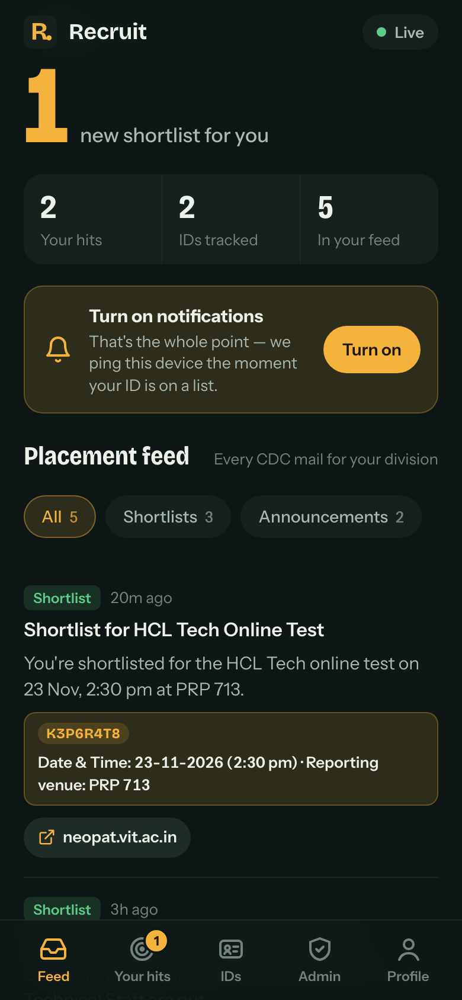
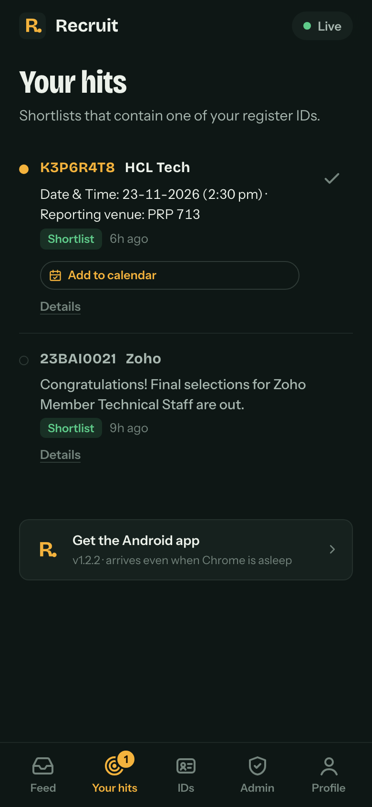
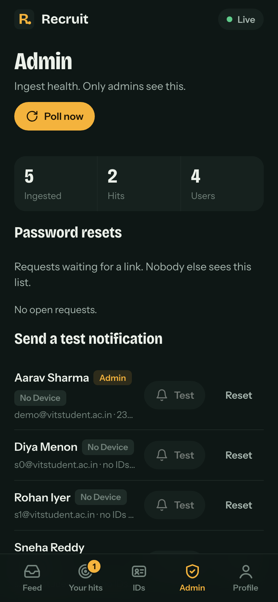
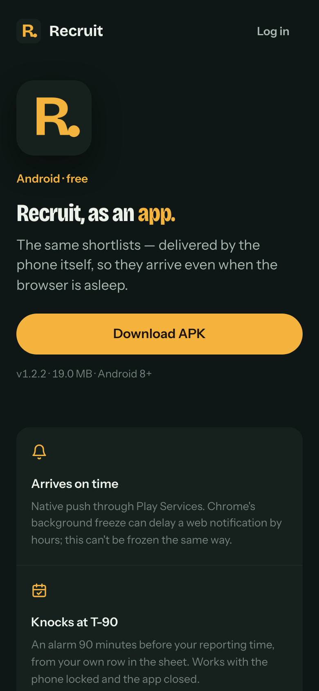

# Recruit

A CDC **placement-notification PWA** for VIT: it watches a CDC placement mailbox
over IMAP, extracts shortlists & registration/test announcements, matches
register IDs and NEO IDs to users, and notifies students the moment they're shortlisted.

Three ways to get notified:

- **Web app (PWA):** VAPID Web Push in any browser. Installable on Android and iOS.
- **Android app** ([`mobile/`](./mobile), Flutter): FCM high-priority push, which
  still arrives when Chrome is frozen. It also sets local alarms 90 and 30 minutes before
  your reporting time. The APK is served from the site itself at `/app`.
- **Calendar file:** each hit with a date and time has *Add to calendar* (`.ics`
  with a T-90 alarm). On iPhone, this is the only reminder that works without an app.

Stack: **FastAPI + SQLite + VAPID Web Push + FCM**, deployed as Docker Compose (3
containers: `app`, `worker`, `backup`). Live at <https://recruit.jaswanth.me>.

> **Never commit secrets.** `.env` and `secrets/` are gitignored. The repo
> contains code + a sanitized `.env.example` only — anyone cloning it gets the
> engine, not your mailbox credentials or push keys.

---

## Screenshots

| Feed: every CDC mail, parsed | Your hits: only lists with your IDs | Admin: ingest health, resets | Android app download |
|---|---|---|---|
|  |  |  |  |

Captured at phone width from a local instance seeded with made-up demo data. No real students or mails are shown.

---

## 1. How the mail-receiving pipeline works

The engine is simple and deterministic — no magic:

```
CDC mailbox ──IMAP──▶ app/ingest.py  ──▶ app/extract.py ──▶ matching ──▶ push
 (imap.gmail.com)     poll worker     (parse body)       (matcher.py)   (web-push + FCM)
```

1. **`worker.py`** starts a `recruit-worker` container that loops `poll_once(db)`
   every `POLL_INTERVAL_MIN` minutes (default 3).
2. **`app/ingest.py` → `connect()`** logs into the IMAP server with
   `CDC_MAILBOX_USER` + `CDC_MAILBOX_TOKEN`.
3. It tracks a **UID cursor** and only fetches *new* messages
   (`UID {last_uid+1}:*`) — so restarting never re-processes old mail.
   On first ever poll it sets a **baseline** at the highest existing UID (it
   does **not** ingest the entire backlog).
4. Each new message is parsed by **`app/extract.py`**: it pulls the subject,
   body, any links, register IDs, and the *Eligible Branches* window.
5. **`app/matcher.py`** matches extracted IDs (register numbers and NEO IDs)
   against users. For each match, `app/push.py` sends a VAPID push to the user's
   browsers and `app/fcm.py` sends a data-only FCM message to their phones. When
   the shortlist row has a date and time, the FCM payload includes `when_iso`, so
   the app can schedule its T-90 alarm without a network connection.
6. Everything lands in SQLite tables (`ingested` = feed, `entries` = IDs per mail
   with their sheet row, `hits` = per-user matches, `users`, `push_subscriptions`,
   `fcm_tokens`, `password_resets`).

The whole pipeline is **stubbed in tests** so the offline test suite never
touches the real network:

```bash
python3 -m pytest -q
```

---

## 2. Getting it running

### Prerequisites
- Docker + Docker Compose
- An IMAP mailbox + app-password (for Gmail: Google account → Security →
  2-Step Verification → App passwords — the 16-char password is
  `CDC_MAILBOX_TOKEN`; `CDC_MAILBOX_USER` is the full email).
- VAPID keys for Web Push:

```bash
npx web-push generate-vapid-keys
```

### Setup
```bash
cp .env.example .env
# edit .env — set real values (see table below)

# create the external network the compose file expects
docker network create proxy 2>/dev/null || true

# build + run (all 3 services)
docker compose build
docker compose up -d
```

The web app listens on **port 8090**. Put it behind a reverse proxy / Cloudflare
tunnel to serve it at a real HTTPS URL (required for Web Push + Secure cookies).

### Verify
```bash
curl -s http://127.0.0.1:8090/health          # -> ok
docker logs recruit-worker-1 --tail 20        # -> "poll: ... cursor=NNNN"
docker ps --filter name=recruit               # app (healthy), worker, backup
```

Run the offline suite from the source checkout (not the container):

```bash
python3 -m pytest -q
```

---

## 3. Configuration — every knob in `.env`

| Variable | Purpose | Empty/off means |
|---|---|---|
| `SECRET_KEY` | Signs session cookies + passwords. **Set to a long random string.** | insecure auth |
| `SESSION_SECURE` | `1` = cookies are Secure-only (HTTPS only) | insecure over plain HTTP |
| `PUBLIC_BASE_URL` | Your public URL (used for links, PWA, push) | — |
| `ADMIN_EMAIL` | Email address that becomes `is_admin` on register | no admin |
| `ALLOWED_EMAIL_DOMAINS` | Comma list of domains allowed to register (`vit.ac.in,...`) | anyone can register |
| `INVITE_CODE` | Optional registration invite code | open registration |
| `CDC_MAILBOX_USER` | IMAP login (email) | **worker won't start polling** |
| `CDC_MAILBOX_TOKEN` | IMAP password / app-password (spaces stripped) | **worker won't start polling** |
| `IMAP_HOST` | IMAP server (`imap.gmail.com`) | defaults to Gmail |
| `IMAP_PORT` | IMAP port (`993`) | defaults to 993 |
| `POLL_INTERVAL_MIN` | Minutes between polls | longer = slower notifications |
| `VAPID_PUBLIC_KEY` / `VAPID_PRIVATE_KEY` | Web Push signing keys | push disabled, app still works |
| `VAPID_SUBJECT` | `mailto:` identifier for the push app | push may be refused |
| `FCM_SERVICE_ACCOUNT` | Path to the Firebase service-account JSON (e.g. `/run/secrets/fcm_service_account.json`) | Android app gets no push; web push unaffected |
| `SMTP_HOST` `SMTP_PORT` `SMTP_USER` `SMTP_PASSWORD` `SMTP_FROM` | Mailer for password-reset links | resets still work: admin hands out the link from the admin panel |
| `APK_DIR` | Where the published APK + `apk.json` live (default `/data/apk`) | no download card |
| `SUMMARIZE_ENABLED` `LLM_*` | Optional LLM summaries over feed | summaries off (deterministic core runs either way) |
| `ENABLE_DEV_ENDPOINT` | Dev-only test endpoints — **keep `0` in prod** | safer |
| `DATABASE_URL` / `LOG_DIR` / `DB_BACKUP_DIR` | Paths; preset by the Dockerfile to `/data/...` | — |

---

## 4. **Pointing it at a DIFFERENT mailbox** (the question everyone asks)

You do **not** touch any code — everything is `.env`-driven.

```ini
#.env
CDC_MAILBOX_USER=your.new.mailbox@gmail.com
CDC_MAILBOX_TOKEN=your-new-app-password
IMAP_HOST=imap.gmail.com      # or imap.outlook.com, etc.
IMAP_PORT=993
POLL_INTERVAL_MIN=3
```

Then restart the worker:

```bash
docker compose up -d --force-recreate worker
```

### What changes & what doesn't
- **The mailbox it watches** → changes (the whole point).
- **The extraction/matching/push logic** → unchanged; it's generic, mailbox-agnostic.
- **A different IMAP provider** (Outlook, Yahoo, Exchange…) → just change
  `IMAP_HOST`/`IMAP_PORT`. The code uses Python's standard `imaplib` over SSL,
  so any IMAP server works. You may also need to allow "less secure apps" or an
  app-password on that provider.
- **Tracking a brand-new mailbox** → the worker baselines on first run (starts
  from the mailbox's current high UID), so it won't ingest the mailbox's old
  backlog. Point `IMAP_HOST` anywhere and it just starts listening for new mail.

> ⚠️ **One live-ops warning:** never run **two pollers against the same mailbox
> at once** (e.g. old + new host during a migration). Their UID cursors race and
> mail can be double-processed. Stop the old one before starting the new.

---

## 5. Mobile app

The Android app lives in **[`mobile/`](./mobile)**. It's a Flutter client with
one Dart codebase for Android and iOS. It talks to the same API as the web app.
It doesn't wrap the web UI in a WebView.

| Why an app at all | What it does |
|---|---|
| Android freezes Chrome in the background, and a frozen browser can't decrypt a Web Push. One shortlist arrived 3.5 hours late this way. | **FCM push** is delivered by Play Services, which Doze doesn't hold back. |
| Browsers have no API for scheduled local notifications. | **Exact alarms at T-90 and T-30** before your reporting time. They come from your own row in the sheet, survive a reboot, and need no network. |

Pieces involved:

- **Server:** `app/fcm.py` sends the messages. `POST /api/push/fcm` registers a
  device token. Needs `FCM_SERVICE_ACCOUNT` (see §3).
- **Build:** `mobile/build-apk.sh` builds a release APK on an x86_64 host. The
  Android SDK tools don't run on the Pi's ARM64. `mobile/build-ios.sh` builds the
  iOS app on a Mac.
- **Ship:** `scripts/publish_apk.py <apk> --notes "..."` copies the APK into
  `APK_DIR` and writes `apk.json`. The site then shows a download card and serves
  `/app` (download page), `/download` (the APK) and `/api/app` (version info).
  No restart needed, and the binary is never committed to git.
- **Firebase setup:** `mobile/android/app/google-services.json` (client) plus the
  service-account JSON on the server. [`android/README.md`](./android/README.md)
  has the step-by-step Firebase setup and the payload contract.

> [`android/`](./android) is the earlier native Kotlin version, a WebView shell
> with FCM and alarms. `mobile/` replaced it as the app that ships.
> `android/README.md` is still the best reference for the Firebase setup and the
> alarm/push design.

---

## Docker services

| Service | Image | Runs | Purpose |
|---|---|---|---|
| `recruit-app` | `recruit` | uvicorn :8090 | web app + API + PWA, healthchecked |
| `recruit-worker` | `recruit` | `python worker.py` | IMAP poll loop |
| `recruit-backup` | `recruit` | nightly `scripts/backup.py` | online SQLite backup into `./data/backups`, keeps last 14 |

All mount `./data:/data` (DB, logs, backups) and `./secrets:/run/secrets:ro`,
and sit on the external `proxy` network.

---

## Project layout

```
app/            FastAPI app: main.py (routes), ingest.py (IMAP poll),
                extract.py (parse), matcher.py (match), push.py (VAPID),
                fcm.py (Android push), ics.py (calendar files),
                reset.py + mailer.py (password reset), apk.py (APK download),
                summarize.py (LLM), models.py, config.py, security.py,
                db.py, web.py, metrics.py, templates/, util.py
static/         PWA: app.js, ids.js, style.css, sw.js, icons
mobile/         Flutter app (Android + iOS), build-apk.sh, build-ios.sh
android/        earlier native Kotlin WebView shell (superseded by mobile/)
scripts/        backup.py, cd-deploy.sh, publish_apk.py, fcm_send_test.py, ...
tests/          offline test suite (network stubbed)
compose.yml     app + worker + backup
Dockerfile      non-root runtime, /data mounted volumes
.env.example    sanitized config template (copy to .env)
```

## Operations
- **Why did X ping / not ping?** — `docker exec recruit-app-1 python3 -c "..."` to
  inspect the SQLite tables (`users`, `ingested`, `hits`, `push_subscriptions`).
- **Force a poll now** — via the admin "poll now" endpoint (admin panel).
- **Someone forgot their password** — they use *Forgot your password?* on the
  login page. Links last 60 minutes and work once. Without SMTP, the request
  shows up in the admin panel's *Password resets* list, where the admin can copy
  the link and send it themselves.
- **Test a user's devices** — the admin panel's *Test* button sends a push to every
  browser and phone that user has registered.
- **Migration / rehost** — copy the whole project *including* `data/`
  (the live DB) and `secrets/`, then bring the stack up; see §4 warning about
  not dual-polling.

## CI / CD — deploy on green push, with a seatbelt

- **CI** — GitHub Actions (`.github/workflows/test.yml`) runs the offline `pytest`
  suite on every push/PR. Green/red check on the repo; no secrets needed.
- **CD** — `scripts/cd-deploy.sh`, driven by the `recruit-cd.timer` systemd unit
  on the production host **abhi**, every 5 minutes. When `origin/main` moves it
  **pulls + rebuilds + restarts** (no fixed window). `flock` serializes so a
  5-min tick never collides with an in-flight Pi-4 build.

### The seatbelt (safety rails on an auto-deploy)
- **CI-green gate** — CD reads the pushed commit's Actions result via the
  authenticated `gh` CLI already on abhi (fallback: a read-only token at
  `secrets/github_ci_token`), and only deploys when it is **green**. With
  neither, it still deploys but logs a loud `WARN: … WITHOUT a CI gate`.
- **Per-SHA image tags** — every build is tagged `recruit:<short-sha>` in
  addition to `recruit:latest`, so a bad deploy has something to fall back to.
- **Health gate + auto-rollback** — after `up`, the script waits for
  `recruit-app-1` to report `healthy`; if it doesn't, it **re-tags the last
  known-good image** (recorded in `data/logs/last_good`) as `latest` and
  recreates. A failed deploy never silently stays live.
- **Opt-in quiet hours** — `touch data/logs/night_only` restores the old
  **22:00–00:00 IST-only** window (for a sensitive/exam period you want frozen).
  Remove the file to go back to deploy-on-push.
- **Hotfix escape hatch** — for an urgent fix:
  ```bash
  scripts/cd-deploy.sh --force   # skip quiet-hours + CI gate, deploy now
  touch data/logs/cd.force       # or arm the next 5-min tick (no SSH)
  ```
  `--force` skips quiet-hours and the CI gate but still health-gates + rolls
  back.

### Watching it
```bash
tail -f ~/Projects/recruit/data/logs/cd.log
# up to date (abc1234)            -> nothing new
# CI green for abc1234            -> gate passed
# deploy abc1234 -> abc1234       -> deploying
# deployed abc1234 (healthy)      -> success
# HEALTH FAILED … / rolled back … -> the seatbelt caught a bad deploy
```

---

## Contributing

See [`CONTRIBUTING.md`](./CONTRIBUTING.md) — dev setup, the offline test suite,
coding conventions, and what the CI/CD pipeline does with your change.